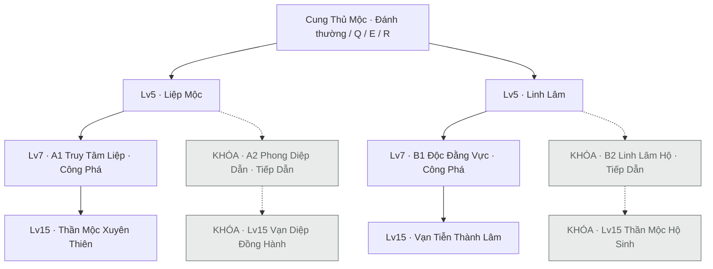

# Cung Thủ hệ Mộc — bản thiết kế thử V0.1

Ngày soạn: 08/10/2026. Trạng thái: **đã có prototype chơi được A1/B1 đến Lv15**. Toàn bộ tên kỹ năng, chỉ số và hệ số bên dưới là lựa chọn thử, chưa chốt balance. **A2/B2 khóa theo yêu cầu người thiết kế**, giữ dữ liệu để mở sau. Không dùng modifier hoặc nghi thức của Stage Kháng Chiến.

Chơi từ Lv1: `/?character=archer`. Phòng thử Lv15: `/?character=archer&sandbox=1`, thêm `&path=b1` để bắt đầu B1. WASD di chuyển; giữ chuột bắn; Q/E rồi click; R dùng trực tiếp; C mở bảng nhân vật. Khi Lv15, đủ 6 Sinh Tức và Q/E đã hồi, Q+E hoặc E+Q trong 0,18s rồi click thi triển đại chiêu. Bấm Esc hủy lựa chọn; mở bảng C/Dev, mất focus hoặc ẩn trang sẽ dừng đồng hồ trận. Preset A1/B1, hồi đầy và xem chậm chỉ nằm trong phòng thử.

Nguồn nền: [CORE_RULES](../../CORE_RULES.md), Combat Core hiện tại và [hai nhánh Pháp Sư Thủy](Water-Mage-Assault-Paths.md). Kế thừa mốc tiến hóa, luật tài nguyên, hit thật và cấu trúc Công Phá/Tiếp Dẫn. Bộ cung, Sinh Tức, Truy Ấn và vườn Mộc là thiết kế mới. Dữ liệu Cung Thủ cũ chỉ có tên nghề, chưa có bộ kỹ năng để chép lại.

## 1. Ý tưởng và cây nhánh

**Bắn trúng để nuôi Sinh Tức; dùng Sinh Tức để tăng nhịp bắn hoặc giữ cho đại chiêu.** Cung Thủ thắng nhờ chọn đường tên và vị trí giao chiến. Hệ Mộc thể hiện qua hạt giống, dây leo, tán lá và sự sinh trưởng, không thêm stat độc tố hoặc một hệ sát thương khác.

| Hướng | Trạng thái thiết kế | Quyết định chính của người chơi | Vai trò | Điểm yếu cần giữ |
|---|---|---|---|---|
| A1 · Truy Tâm Liệp | Mở | Giữ Ấn trên mục tiêu quan trọng, bắn xuyên đúng đường | Dồn damage một mục tiêu, xuyên hàng địch | Tên bị chặn; hụt đòn mất cơ hội; tụ đại chiêu dễ bị áp sát |
| A2 · Phong Diệp Dẫn | **Khóa** | Chọn mục tiêu cho đội bắn, cấp nhịp rồi di chuyển cùng đội | Trợ lực MP, tốc độ đánh và di chuyển | Burst thấp; đội không đánh mục tiêu có Ấn thì mất hiệu quả |
| B1 · Độc Đằng Vực | Mở | Đặt hai vườn thành hành lang, giữ hay thu hoạch vườn | Kiểm soát đường đi, damage kéo dài và dọn nhóm | Địch rời vùng hoặc đổi hướng thì mất phần lớn damage |
| B2 · Linh Lâm Hộ | **Khóa** | Đặt vườn nơi đội có thể đứng, chọn thời điểm cứu bằng Q | Hồi HP và khiên theo khu vực | Đội phải ở gần vườn; tiêu MP đáng kể; thiếu burst |

Lv5 chọn một lõi; Lv7 hiện chỉ chọn Công Phá tương ứng: Liệp Mộc → A1, Linh Lâm → B1. Lv9/11/13/15 tiếp tục đúng hướng đã chọn. **A2/B2 khóa ở mọi mốc 7/9/11/13/15**, kể cả khi đã có định nghĩa hiệu ứng; không thể chọn, cast đại chiêu hoặc nhận proc/buff của hai hướng này. Khóa sản phẩm độc lập với trạng thái đã triển khai. Chỉ mở lại khi người thiết kế yêu cầu rõ ràng.

Không ghép hướng, bỏ mốc hoặc đổi hướng trong cùng run. Các hiệu ứng mốc trước được giữ, trừ nơi ghi rõ thay thế. Khi triển khai, A1/B1 cũng chỉ được chọn sau khi có gameplay thật; chữ “Mở” ở bảng này không có nghĩa runtime đã tồn tại.

## 2. Luật và cách đọc công thức

- Chỉ một ATK, một DEF; mọi damage của class mang hệ `wood`. Mộc khắc Thổ ×1,25; bị Kim khắc ×0,80; các quan hệ khác ×1,00. Không tự tăng damage vì Mộc sinh Hỏa hoặc được Thủy sinh.
- Tên phải chạm body; vườn kiểm tra body ở từng nhịp. Không homing, auto-hit, xuyên tường, bỏ DEF hoặc damage theo % HP địch. “Xuyên” trong tên kỹ năng chỉ có nghĩa đi qua nhiều body địch.
- AoE/vườn cần body overlap và đường từ tâm vùng tới body không bị vật cản chặn projectile che. Tâm trồng phải là điểm mặt đất hợp lệ. Kiểm tra này thuộc adapter va chạm khi triển khai, không tự lấy một tọa độ đẹp trong VFX làm confirmed hit.
- Damage qua Core: raw → Crit nếu cho phép → DEF → Ngũ Hành → khiên → HP. `DEF_SCALE = 50`. Đánh thường và Q cho phép Crit; E, damage phụ, DoT và đại chiêu không Crit trong bản thử này.
- `A` là ATK của caster chụp lúc commit; `M` là Max MP chụp cùng lúc. R, potential và các buff có sẵn phải được tính trước khi chụp. Buff mới sau commit không sửa đạn hoặc vườn cũ.
- `P = 120` chỉ là hệ số thử cho **damage đại chiêu Lv15**, dùng để đối chiếu với scale đại chiêu Pháp Sư hiện tại. Không nhân P vào đòn thường, Q/E/R, khiên hoặc hồi HP/MP.
- Hồi HP/MP đi qua API chung và clamp; không hồi sinh, không tự nhận EXP/điểm từ hồi phục. Không có accuracy, evasion hay HP regen thụ động.

## 3. Chỉ số nền và tiềm năng

Không tăng stats tự động bằng level. Level cấp điểm theo Core: 5 điểm đầu, +5 mỗi level, tổng 75 ở Lv15. Mọi chỉ số derive lại từ base + allocation + modifier, giữ tỷ lệ HP/MP khi Max thay đổi.

| Chỉ số | Base thử |
|---|---:|
| Max HP | 120 |
| Max MP | 130 |
| ATK / DEF | 13 / 6 |
| MP regen | 1,8 MP/s |
| Move speed | 165 world unit/s |
| Attack interval / sàn | 0,90s / 0,45s |
| Attack Speed Rating | 0 |
| Crit chance / damage | 5% / ×1,50 |

| Một điểm | Hiệu ứng thử |
|---|---|
| STR | +0,5 ATK |
| DEX | +0,3 ATK, +1 Attack Speed Rating, +0,2 DEF |
| SPI | +4 Max MP, +0,04 MP/s |
| VIT | +6 Max HP |
| LUK | `CritChance = 0,05 + 0,45 × LUK / (LUK + 75)` |

`AttackInterval = max(0,45; 0,90 / (1 + tổng Rating / 100))`. Buff rating cộng vào rating từ DEX, rồi derive interval một lần. DEX không giảm cooldown kỹ năng và không tăng tốc độ đạn. Move speed chỉ đổi bởi modifier rõ nguồn, không tăng ngầm từ DEX.

STR ưu tiên lượng damage mỗi lần tung chiêu; DEX ưu tiên nhịp đánh, Sinh Tức và DEF. SPI có giá trị rõ cho B2 và duy trì MP, không tự tăng damage Mộc. Đây là giả thuyết build, cần đo để tránh DEX hoặc STR trở thành lựa chọn luôn tốt hơn.

## 4. Bộ kỹ năng gốc — Lv1 đến trước khi chọn nhánh

Q/E/R có sẵn ở rank nền để thử class. Skill Points vẫn được ghi theo Core; bản này không thêm cơ chế tăng rank bằng Skill Points. Sự phát triển kỹ năng ở các mốc tiến hóa bên dưới.

| Nút | Tên | Cơ chế |
|---|---|---|
| Chuột | Mộc Tiễn | Mỗi lần bắn một tên, raw = `1A`, 0 MP; giữ chuột bắn theo attack interval. Tầm 560, speed 820, radius 4. Dừng ở địch đầu tiên hoặc vật cản. |
| Nội tại | Sinh Tức | Tối đa 6 điểm. Một đòn thường gốc trúng hoặc Q gốc trúng địch cho +1, tối đa một lần cho cả lệnh bắn/Q, bất kể số tên và số địch. |
| Q | Xuyên Diệp | 18 MP, CD 4s. Chọn hướng bằng click; tụ 0,35s rồi phóng tên. Raw `3A`; tầm 650, speed 900, radius 6. Xuyên tối đa 3 địch, tỷ lệ damage lần lượt 100/75/50%. |
| E | Hạt Đằng | 20 MP, CD 7s. Chọn điểm trong tầm 450; hạt bay speed 650, bị vật cản chặn. Đáp rồi cần 0,45s để sẵn sàng; chờ tối đa 8s, tối đa một hạt. |
| R | Khai Cung | 30 MP, CD 12s và cần 3 Sinh Tức. Tiêu đúng 3 điểm; trong 8s, ba lệnh đánh thường/Q kế tiếp có raw chính ×1,35. E không dùng lượt R. |

**Chi tiết E:** hạt sẵn sàng gặp địch trong bán kính 55 thì nổ một lần: `1,25A`, giữ chân 0,75s rồi làm chậm 25% trong 1,25s. Bẫy mất sau nổ. Không gây damage khi còn đang chờ. Chạm vật cản trước khi đáp thì hủy hạt, không tạo bẫy phía sau tường.

**Nhịp thi triển:** tên thường có windup 0,10s, vẫn di chuyển ở 80% tốc độ; trong windup Q đi ở 70%. Sau phóng trở lại bình thường. Hướng chụp từ cung ở độ cao 28 trên chân khi bắt đầu commit; từng tên gốc/đại chiêu phóng từ vị trí cung hiện tại, không đổi hướng giữa chuyến bay. Vĩ Tiễn giữ điểm phóng của Q gốc. Một lệnh thường chỉ tạo một tên, không có tụ Thủy Pháo hoặc cơ chế phản xạ kính.

**Sinh Tức:** cộng sau confirmed hit với `finalDamage > 0`, kể cả damage bị khiên hấp thụ hết. Trượt, chạm tường, E, DoT, damage phụ, đồng đội và đại chiêu không cấp điểm. Ở 6 điểm thì bỏ phần cộng dư, không đổi thành MP. Không tự giảm theo thời gian; về 0 khi chết hoặc bắt đầu run mới. R và đại chiêu cạnh tranh cùng tài nguyên, không thể dùng chung sáu điểm trong một lần commit.

Điều kiện Ấn/vườn tại hit được chụp trước khi giải damage; proc hợp lệ xử lý sau kết quả Core rồi mới dọn target chết. Đòn kết liễu vẫn nhận Sinh Tức/proc của đòn gốc, nhưng không sinh damage tiếp lên xác chết. Caster đã chết không được xử lý proc đang chờ.

Một Q nhiều mục tiêu/tên vẫn tiêu một lượt R; raw và trạng thái R chụp lúc commit Q. Đánh thường tiêu lượt khi thực sự phóng. Lượt hết hạn không hoàn điểm/MP. Không cho R mới ghi đè R đang còn lượt và thời hạn.

Ở kỹ năng quạt có trần hai tên/target, tên thứ ba chạm cùng body vẫn bị chặn và mất, nhưng không gây damage hoặc proc; không xuyên qua body đó để tìm target mới. Thứ tự va chạm/nhận buff hòa nhau xử lý theo thời điểm rồi ID, không phụ thuộc thứ tự actor trong mảng.

**Khống chế của riêng Cung Thủ:** một caster chỉ đặt root lên cùng một địch tối đa một lần mỗi 6s, dùng chung giữa E và đại chiêu. Cooldown này bắt đầu khi root được áp thành công. Root không cấm địch tấn công; slow cùng họ dùng mức mạnh nhất, không cộng chậm thành đứng yên. Không sửa luật root của Pháp Sư hoặc tự thêm miễn nhiễm boss.

## 5. Lõi Lv5

### A — Liệp Mộc

Tên thường gốc trúng địch đặt **Truy Ấn** lên địch đó trong 6s, chỉ một mục tiêu có Ấn của caster. Đánh lại làm mới; đổi mục tiêu chuyển Ấn. Damage của đòn đầu được xử lý trước khi đặt Ấn.

Đánh thường/Q gốc trúng mục tiêu đang có Ấn của mình được +15% raw chính. Q không đặt hoặc chuyển Ấn. Ấn mất khi địch chết/rời khu/mất hợp lệ, caster chết hoặc hết hạn. Các caster có Ấn riêng; không dùng Ấn người khác.

### B — Linh Lâm

E giảm CD từ 7s xuống 6s; tối đa hai slot, tính cả hạt đang chờ và vườn đã mọc. Trồng hạt thứ ba giải phóng slot cũ nhất theo thời điểm trồng rồi ID, không hoàn MP.

Hạt nổ giữ damage/root gốc, sau đó trở thành **vườn Mộc** bán kính 65 trong 8s. Địch ở trong vườn bị chậm 25%, rời vùng thì mất slow của vườn. Vườn không có hitbox chắn đi lại, không làm tường và chưa tự gây DoT hoặc hồi HP ở Lv5. B1/B2 bổ sung tác dụng tại Lv7.

## 6. A1 — Truy Tâm Liệp / Công Phá

| Mốc | Tên | Thay đổi đầy đủ |
|---|---|---|
| 7 | Truy Tâm Tiễn | Q gốc chạm địch đang có Truy Ấn thêm `1,5A` vào raw của hit rồi tháo Ấn. Với tỷ lệ xuyên `f`, raw hit này = `f × (3A × 1,15 + 1,5A) × hệ số R`. Qua Crit/DEF một lần. Q hụt không tháo Ấn. |
| 9 | Lùi Bước Giương Cung | E thay chọn điểm bằng chọn hướng: đặt Hạt Đằng tại chân rồi lùi 90 trong 0,25s ngược hướng click. MP/CD giữ nguyên. Di chuyển có va chạm, không bất tử/teleport; bị chặn vẫn đặt hạt tại chân. |
| 11 | Xuyên Tán | Q tăng tối đa 5 địch, tỷ lệ raw 100/85/70/55/40%; mỗi body chỉ trúng một lần cho mỗi tên. Vật cản vẫn chặn. |
| 13 | Song Mộc Tiễn | Q dùng lượt R phóng thêm Vĩ Tiễn sau 0,12s từ cùng điểm và cùng hướng đã chụp. Vĩ Tiễn raw `1,8A × hệ số R`, tầm 650, speed 900, radius 4, dừng ở địch đầu tiên; không Crit/Ấn/Sinh Tức hoặc kích tiếp lượt R. Không lấy damage bonus tháo Ấn để nhân thêm. |
| 15 | Thần Mộc Xuyên Thiên | Đại chiêu ba tên lớn cùng đường; chi tiết dưới đây. |

**Thần Mộc Xuyên Thiên:** cần 6 Sinh Tức, 60% Max MP, CD đại chiêu 30s. Chọn hướng; tụ 1,2s ở 50% move speed, rồi phóng ba tên cách nhau 0,12s. Raw lần lượt `12A×P`, `12A×P`, `18A×P`; tầm 800, speed 1100, radius 8. Mỗi tên xuyên tối đa năm địch, tỷ lệ 100/80/60/40/20%. Các tên cùng heading, không xoay đuổi mục tiêu.

Chụp target ID của Truy Ấn khi commit. Nếu tên thứ ba chạm đúng target và Ấn đó vẫn hợp lệ, cộng `3A×P` trước tỷ lệ xuyên và tháo Ấn. Hai tên đầu không tháo Ấn. Đại chiêu không hưởng +15% của lõi A, không dùng R hoặc kích Song Mộc Tiễn.

Tên thứ ba là phần thưởng cho đọc đường đi, không phải đòn tự đảm bảo trúng. Không bắn thường/Q/E/R trong pha tụ và phóng; mở lại sau tên thứ ba đã phóng. Tên đã phóng vẫn đi theo collision thật.

**Combo:** thường đặt Ấn → Q tháo Ấn → E lùi nếu bị áp sát → thường tích lại. Khi quyết định dùng đại chiêu, giữ đủ 6 Sinh Tức và Ấn cho mục tiêu quan trọng thay vì tiêu R trước.

## 7. A2 — Phong Diệp Dẫn / Tiếp Dẫn — KHÓA

Phần lưu trữ thiết kế để mở sau; toàn bộ mốc, proc và đại chiêu bên dưới không được kích hoạt trong bản hiện tại.

| Mốc | Tên | Thay đổi đầy đủ |
|---|---|---|
| 7 | Dẫn Tiễn | Đòn gốc thực sự trúng mục tiêu có Truy Ấn của caster hồi 2% Max MP của người đánh cho chính người đánh. Áp dụng caster/đồng đội còn sống, trong 600 từ caster; không áp dụng damage phụ/DoT. Mỗi người tối đa một proc mỗi 2s, dùng chung gate này giữa các A2. |
| 9 | Phong Bộ | E giữ bẫy, thêm vòng lá bán kính 70 từ lúc hạt sẵn sàng đến khi hạt nổ/hết hạn. Bản thân và tối đa ba đồng đội đi vào nhận +12% move speed trong 4s, mỗi người một lần/E. Buff đi theo người sau khi rời vòng; enemy vẫn kích bẫy như thường. |
| 11 | Cộng Nhịp | Người được hồi MP bởi Dẫn Tiễn nhận thêm +30 Attack Speed Rating trong 4s. Làm mới thời hạn, không cộng nhiều lớp cùng họ. |
| 13 | Tán Diệp Tiễn | Q dùng lượt R thay một tên xuyên bằng ba tên quạt ở −12°/0°/+12°, mỗi tên `1,6A × hệ số R`, tầm/speed/radius giữ Q, mỗi tên dừng ở địch đầu tiên. Cùng một địch nhận tối đa hai tên/Q. Các tên vẫn nhận bonus Ấn nếu đủ điều kiện; cả Q chỉ +1 Sinh Tức và dùng một lượt R. |
| 15 | Vạn Diệp Đồng Hành | Đại chiêu bắn quạt và cấp buff di động cho đội, không tạo vườn cố định. |

**Vạn Diệp Đồng Hành:** cần 6 Sinh Tức, 50% Max MP, CD 30s. Chọn hướng, tụ 0,6s ở 75% move speed; phóng bảy tên theo góc −30°/−20°/−10°/0°/+10°/+20°/+30°. Mỗi tên raw `3A×P`, tầm 600, speed 1000, radius 6; dừng ở địch đầu tiên/vật cản. Một địch nhận tối đa hai tên cả loạt. Không kích Ấn, Dẫn Tiễn, Sinh Tức hoặc R.

Khi phóng, caster và tối đa ba đồng đội hợp lệ trong hình quạt 60°/tầm 600 nhận +20% move speed và +60 Attack Speed Rating trong 6s. Đồng đội phải không bị vật cản che đường từ caster; hòa chọn người gần hơn rồi ID. Đồng đội được hồi thêm 10% Max MP của **chính họ**, một lần; caster nhận buff nhưng không nhận phần hồi MP này. Không cần đủ người mới cast; solo vẫn dùng được.

Buff tốc độ cùng họ lấy mức mạnh nhất: Cộng Nhịp 30 không cộng thêm vào 60 của đại chiêu; Phong Bộ 12% không cộng thêm vào 20%. Rating từ DEX vẫn cộng vào mức buff được chọn. Không vượt sàn attack interval 0,45s.

Phong Bộ giữ danh sách người đã nhận của từng E; khi nhiều người vào cùng tick, chọn đồng đội gần tâm hơn rồi ID cho ba slot. Caster không chiếm slot đồng đội. Nếu ally và enemy cùng vào ở tick hạt sẵn sàng, xử lý buff ally trước lần nổ bẫy.

**Combo:** thường đánh dấu địch đang bị đội tập trung → E cấp Phong Bộ ở đường đội đi qua → Q/R giữ nhịp bắn → đại chiêu trước lúc đội tiến lên hoặc rút khỏi một đòn nguy hiểm. A2 tăng hiệu quả hành động của đội, không hồi HP và không cần nối dây.

## 8. B1 — Độc Đằng Vực / Công Phá

“Độc” là tên hình ảnh cho damage Mộc theo thời gian; không thêm Poison Resistance hoặc damage bỏ DEF.

| Mốc | Tên | Thay đổi đầy đủ |
|---|---|---|
| 7 | Độc Nha | Vườn gây `0,7A` mỗi 1s lên địch còn ở trong. Không Crit. Hai vườn chồng không nhân đôi DoT cùng caster. |
| 9 | Liên Đằng | Hai vườn đã mọc, cách nhau không quá 300, tạo hành lang dây leo giữa tâm: capsule radius 16. Địch trong hành lang chậm 50%, chịu `0,4A/s`; vườn mất thì đoạn nối mất. Đường nối không vượt qua vật cản và không chắn bước chân. |
| 11 | Ngạnh Đằng | Q gốc để lại đường gai dọc đoạn đã bay, dài tối đa 300 tính từ điểm phóng, capsule radius 10, tồn tại 3s, raw `0,6A/s`. Đoạn kết thúc tại va chạm cuối/hết tầm; không mọc xuyên tường. Tối đa hai đường gai; thay đường cũ nhất. |
| 13 | Thu Hoạch Đằng | Q dùng lượt R, chạm địch ở trong vườn, thu hoạch một vườn tại hit: nổ trên vùng vườn đó rồi xóa nó. Raw = `1,5A × min(3; số giây còn lại của vườn) × hệ số R`. Chọn vườn sắp hết trước rồi ID nếu chồng vùng. Chỉ một lần/Q; damage phụ không Crit/proc. Đường nối tới vườn bị thu hoạch cũng mất. |
| 15 | Vạn Tiễn Thành Lâm | Đại chiêu phủ một vùng bằng tên và rừng gai; có thưởng chuẩn bị vườn. |

**Luật DoT:** vườn, hành lang và đường gai dùng một đồng hồ nhịp 1s của caster, bắt đầu sau khi vùng đầu tiên hoạt động. Thêm vùng không tạo nhịp tức thời. Mỗi nhịp, mỗi địch nhận một packet từ vùng hợp lệ có raw mạnh nhất; không cộng mọi vùng cùng caster. Snapshot A riêng từng vùng. Caster khác có nguồn riêng.

Ngạnh Đằng hình thành khi tên Q kết thúc, dùng trace đã bay thật; không vẽ trước một đường qua phần tên chưa tới hoặc đã bị tường chặn. Đường gai bắt đầu tính 3s tại lúc đó; không dùng projectile đại chiêu để tạo gai.

**Vạn Tiễn Thành Lâm:** cần 6 Sinh Tức, 60% Max MP, CD 30s. Chọn tâm trong tầm 450, radius 140. Khi commit, thu tối đa hai hạt/vườn E của mình có tâm nằm trong vòng đã chọn; chưa mọc cũng hợp lệ. Ghi `n = 0/1/2`, xóa đúng các slot được thu và đoạn nối liên quan; hạt ngoài vòng giữ nguyên. Không hút vườn người khác hoặc đường gai Q.

Tụ 1s ở 50% move speed. Tại kết thúc tụ và sau đó +1s/+2s, ba loạt tên đáp gây mỗi loạt `6A×P` lên mỗi địch thực sự trong vùng. Đây là ba AoE gameplay riêng, không đếm từng tên trang trí trong hình. Sau loạt đầu, rừng gai tồn tại 6s, mỗi giây gây `(3+n)A×P`, tổng đúng sáu nhịp nếu địch ở lại. Nhịp DoT chung đặt lại ở thời điểm rừng mọc +1s; trong vùng lấy damage rừng thay các DoT thường yếu hơn. Hết rừng tiếp tục nhịp thường, không dồn nhịp bị bỏ.

Rừng làm chậm 25%; loạt đầu có thể root 0,75s theo gate chung của Cung Thủ. Không kéo địch vào tâm, không gia hạn vùng hoặc tích damage nổ cuối. Sau pha tụ có thể đi lại/bắn kỹ năng thường; vùng vẫn cố định. Điểm yếu là enemy có thể rời vòng.

**Combo:** E đặt hai vị trí để tạo hành lang → Q tạo gai ở lối thoát → chọn giữ DoT hay R+Q thu hoạch → trước đại chiêu, đặt hạt trong vùng dự định để được `n`, nhưng phải giữ lại 6 Sinh Tức.

## 9. B2 — Linh Lâm Hộ / Tiếp Dẫn — KHÓA

Phần lưu trữ thiết kế để mở sau; toàn bộ mốc, proc và đại chiêu bên dưới không được kích hoạt trong bản hiện tại.

| Mốc | Tên | Thay đổi đầy đủ |
|---|---|---|
| 7 | Dưỡng Mầm | E sau khi sẵn sàng mọc ngay thành vườn, không chờ enemy. Giữ vòng 65/duration 8s. Enemy đầu tiên vào vẫn nhận một lần damage/root E. Vườn hồi `2% M` mỗi 2s cho caster/đồng đội còn sống trong vùng. |
| 9 | Hộ Bì | Mỗi actor vào một vườn E của mình nhận khiên `6% M`, hạn 4s, tối đa một lần/actor/E. Tối đa một lớp họ Hộ Bì của cùng caster trên một actor; quy tắc bên dưới. |
| 11 | Ghép Rễ | Q gốc trúng enemy đang trong vườn chọn một người ở trong vườn của mình có % HP thấp nhất, rồi HP/ID, hồi `4% M`. Tối đa một proc/Q, dù Q xuyên nhiều enemy; caster cũng hợp lệ. |
| 13 | Tán Lá Phân Sinh | Q dùng lượt R và proc Ghép Rễ thay heal một người bằng **tổng ngân sách `8% M`**, chia đều cho tối đa ba người có % HP thấp nhất trong các vườn. Bỏ người đầy HP; phần thừa do clamp bị mất, không tự chuyển sang người khác. Solo nhận toàn ngân sách nếu còn thiếu HP. |
| 15 | Thần Mộc Hộ Sinh | Đại chiêu dựng cây hộ trận: khiên một lần, heal theo vùng; không hồi sinh. |

Vườn thường có chung đồng hồ heal 2s của caster; thêm/chồng vườn không tạo nhịp heal riêng. Mỗi nhịp kiểm tra vị trí hiện tại, caster nếu trong vùng và tối đa ba đồng đội, chọn đồng đội theo % HP/HP/ID. Không làm vườn DoT B1, hành lang Liên Đằng hoặc dây nối Mage.

**Hộ Bì:** so với lớp cùng caster đang còn hiệu lực, nếu amount mới không lớn hơn remaining thì bỏ lần cấp mới, không làm mới hạn của lớp lớn. Nếu lớn hơn, thay lớp đó bằng amount/hạn mới. Khiên từ nguồn khác giữ luật Core. Vì vậy E nhỏ không kéo dài khiên đại chiêu lớn; bước ra khỏi vườn vẫn giữ khiên đến hạn, nhưng không còn được heal.

**Thần Mộc Hộ Sinh:** cần 6 Sinh Tức, 60% Max MP, CD 30s. Chọn tâm tầm 450, radius 160, tụ 1s ở 50% move speed. Cây tồn tại 8s từ kết thúc tụ. Khi cây mọc, caster/đồng đội trong vùng nhận một lần khiên Hộ Bì `20% M`, hạn 8s; người đến sau không nhận phần khiên này.

Cây hồi `4% M` mỗi 1s, tám nhịp, cho người còn sống và ở trong vùng; tối đa caster + ba đồng đội mỗi nhịp. Root địch lần đầu đi vào 0,75s theo gate 6s, mỗi địch chỉ một lần/cây; làm chậm 25% khi ở trong. Cây không gây damage, không chặn đạn/bước chân và không là actor có HP trong bản này.

Vườn E được giữ, nhưng người trong cây chỉ nhận heal định kỳ của cây thay heal vườn. Giữa hai lần heal định kỳ từ vườn/cây của cùng caster lên cùng actor cách tối thiểu 1s, kể cả đổi vùng. Heal trả phí từ Q là kênh riêng, có thể thêm vào. Không nhân heal theo số enemy hoặc vườn. Sau tụ vẫn dùng kỹ năng thường; solo có thể tự cứu rồi tiếp tục bắn.

Với các nhịp ghi đủ 1..6 hoặc 1..8, nhịp cuối tại deadline được xử lý trước xóa vùng, rồi hết hiệu lực ngay. Vẫn kiểm tra caster/recipient còn sống, vị trí và va chạm tại nhịp cuối; không phát một packet muộn để bù cho người đã ra khỏi vùng.

**Combo:** E đặt nơi đội có thể giữ vị trí → thường/Q nuôi Sinh Tức và heal đúng người → R+Q chia heal khi nhiều người bị thương → cây hộ trận trước cửa sổ damage lớn, không đợi mọi người gần chết mới tụ.

## 10. Thao tác đại chiêu và vòng đời

Đại chiêu Lv15 dùng **Q+E hoặc E+Q trong 0,18s → click**. Bản hiện tại chỉ có A1 chọn hướng và B1 chọn tâm; A2/B2 không cho vào bước chọn hoặc commit. Cần đúng nhánh Lv15 đang mở, 6 Sinh Tức, đủ MP, Q/E hết cooldown và không có pha windup/thi triển của mình đang chạy. R đã bật được giữ nguyên nhưng không cường hóa đại chiêu.

| Hướng | MP commit | Sinh Tức | Tụ | Hồi chiêu |
|---|---:|---:|---:|---:|
| A1 | 60% M | 6 | 1,2s | 30s |
| A2 · KHÓA, số lưu trữ | 50% M | 6 | 0,6s | 30s |
| B1 | 60% M | 6 | 1,0s | 30s |
| B2 · KHÓA, số lưu trữ | 60% M | 6 | 1,0s | 30s |

Commit tại click, kiểm tra lại điều kiện, trừ MP/điểm và bắt đầu CD cùng một bước. Hủy lựa chọn bằng Esc, mất focus hoặc mở bảng trước click không tiêu tài nguyên. Click sai hướng/điểm hoặc thiếu điều kiện không đổi MP, Sinh Tức, R, Ấn hay vườn.

Chỉ buffer Q/E khi có thể dùng đại chiêu: phím đơn sau 0,18s chọn kỹ năng thường; click sớm xác nhận phím đơn ngay. Không đủ điều kiện thì Q/E thường phản hồi ngay. Key repeat không tạo thêm combo. Sau commit vẫn nhận damage và có thể chết; chết hủy windup, tên, hạt, Ấn, R, vườn và mọi effect đang chờ của caster. Không hoàn chi phí khi chết/hụt đòn.

Mở Dev/bảng nhân vật, mất focus hoặc ẩn trang dùng đồng hồ combat tạm dừng như lượt chơi thường hiện tại. Kết thúc/chuyển khu hủy projectile/effect tại khu cũ; reset riêng Ấn/vùng/đồng hồ proc của khu. Chuyển khu giữ HP/MP/progression/Sinh Tức, nhưng kết thúc run hoặc tạo run mới xóa state theo Core. Không tự hồi HP/MP khi chuyển khu.

## 11. Số thử và mẫu build — không phải benchmark runtime

Các số này là **ước tính công thức**, dùng damage resolver hiện tại để kiểm tra DEF/hệ và số học. Chưa mô phỏng actor Cung Thủ, projectile, AI, miss, cooldown hay nhịp thao tác. Không coi chúng là chứng minh class đã cân bằng hoặc chơi được.

[Dữ liệu ước tính](../../outputs/wood-archer/formula-estimate.json) lưu giả định, stats từng build và các packet; đây không phải log combat Cung Thủ.

Số của A2/B2 trong phần này là dữ liệu lưu trữ cho thiết kế đang khóa, không phải hướng được chọn trong bản hiện tại.

| Hướng | Phân bổ 75 điểm STR/DEX/SPI/VIT/LUK | ATK | Max MP | HP | Interval |
|---|---|---:|---:|---:|---:|
| A1 | 40 / 25 / 0 / 10 / 0 | 40,5 | 130 | 180 | 0,720s |
| A2 | 20 / 30 / 15 / 10 / 0 | 32 | 190 | 180 | 0,692s |
| B1 | 40 / 15 / 10 / 10 / 0 | 37,5 | 170 | 180 | 0,783s |
| B2 | 10 / 15 / 40 / 10 / 0 | 22,5 | 290 | 180 | 0,783s |

Damage tính trên một địch 1.000.000 HP, DEF 50, cùng hệ Mộc, không khiên/Crit/buff ngoài. Target đầu trên đường tên; enemy ở lại vùng đủ nhịp. B2 tính trên đồng đội đủ thiếu HP và không bị damage phá khiên trong lúc đo ngân sách.

| Đại chiêu | Raw dự kiến | Damage thực / ngân sách |
|---|---:|---:|
| A1 trúng cả ba tên, không bonus Ấn | `42×40,5×120 = 204.120` | 102.060 damage, 10,21% HP mẫu |
| A1 có bonus Ấn ở tên thứ ba | `45×40,5×120 = 218.700` | 109.350 damage, 10,94% |
| A2 một tên trúng | `3×32×120 = 11.520` | 5.760 damage; thêm buff đội |
| A2 hai tên trúng cùng một enemy | `6×32×120 = 23.040` | 11.520 damage, là trần trên enemy đó |
| B1 không thu hạt/vườn, đủ ba loạt và sáu nhịp | `36×37,5×120 = 162.000` | 81.000 damage, 8,10% |
| B1 thu hai slot, đủ cả chuỗi | `48×37,5×120 = 216.000` | 108.000 damage, 10,80% |
| B2, mỗi người đủ tám nhịp | Không có raw damage | 58 khiên + 92,8 HP hồi; caster tiêu 174 MP |

B2 bốn người đủ điều kiện có tổng ngân sách 232 khiên + 371,2 HP hồi. Không cộng khiên và HP thành “damage gây ra”; không mặc định ngân sách đều được sử dụng. A2 +60 Rating làm build mẫu từ interval 0,692s xuống 0,474s trong 6s, khoảng +46,15% số đòn nếu người chơi bắn liên tục; DPS thực còn phụ thuộc hit và thời gian phải di chuyển.

Ước tính giữ P = 120 để A1/B1 cùng bậc với đại chiêu Pháp Sư trên bia mẫu. Mục tiêu khoảng 10% HP **chỉ là đối chiếu**, không là công thức %HP hoặc cam kết mọi build/mọi boss đều mất 10%. Support không cần đạt cùng burst với Công Phá.

## 12. Phản biện trước khi đưa vào game

1. **P = 120 đang quá tách biệt với damage kỹ năng thường.** Ví dụ A1 tên thường raw 40,5, trong khi ba tên đại chiêu raw 204.120. Tăng hệ số để vượt bài đo boss 1 triệu HP chưa chứng minh combat thường hợp lý. Phải đo đóng góp damage trong cả encounter rồi chọn scale boss, class và cooldown cùng nhau; đừng chỉ thêm một số 0 cho vừa bia.
2. **Không thiết kế bốn nhánh thành bốn màu của cùng một AoE.** A1 cần đường tên; A2 cần mục tiêu đội tập trung và buff di động; B1 cần hình học khu vực; B2 cần quyết định giữ vùng/cứu người. Nếu prototype không buộc bốn quyết định này khác nhau, thiết kế chưa đạt.
3. **Phạt hụt đòn phải đủ rõ.** Sinh Tức không sinh từ cast hụt; R tiêu lượt khi bắn; đại chiêu đã commit không refund. Bù lại đừng khóa người chơi đứng yên quá lâu: vũ khí cơ bản phải cho phép vừa đi vừa bắn.
4. **DEX so với STR phải đo ở nhiều cửa sổ.** DEX có ATK/rating/DEF và nuôi điểm nhanh, STR có damage mỗi phát lớn. So sánh burst 5s, DPS 30s, số MP tiêu và sống sót, không chỉ bảng ATK.
5. **A2/B2 solo phải vẫn có vòng chơi.** A2 tự hưởng nhịp/MP nội tại và bắn quạt; B2 tự được heal/khiên nhưng dọn quái chậm hơn. Không tự cấp buff solo khổng lồ để che sự yếu của nhánh support.
6. **Co-op cần giới hạn theo nguồn và recipient.** Dẫn Tiễn có gate 2s chung để nhiều A2 không nhân MP; buff tốc độ cùng họ lấy mạnh nhất. B2 nhiều caster vẫn có heal/khiên riêng theo luật đã viết: cần thử đội bốn B2 trước khi chốt, không tuyên bố đã an toàn chỉ vì một caster có cap.
7. **Cây và vườn chưa phải triệu hồi có HP.** Đưa vào aggro, va chạm hoặc cho chặn đạn sẽ đổi vai trò và cần thiết kế riêng. VFX nhiều lá/tên không được tạo thêm hit hoặc che dấu báo boss.

## 13. Checklist chấp nhận khi làm bản chơi thử

| Nhóm | Kết quả cần kiểm tra |
|---|---|
| Cây nhánh | Đủ mốc A1/B1 5/7/9/11/13/15; A2/B2 bị từ chối ở mọi mốc và không cast/proc; không đổi lõi, ghép hướng hoặc chọn gameplay chưa tồn tại |
| Tên và hit | 30/60/120 FPS cùng số hit; không xuyên tường; mỗi projectile không hit cùng body hai lần; fan giữ trần hai tên/target |
| Sinh Tức/R | Miss/secondary/DoT không cấp điểm; nhiều body không farm điểm; R và đại chiêu không tiêu cùng điểm; chết dọn mọi đạn/effect |
| A1 | Ấn kiểm tra đúng nguồn/hạn; Q tháo một lần; Vĩ Tiễn không sao chép bonus; đại chiêu không tự đuổi enemy |
| A2 · sau khi được yêu cầu mở khóa | Chỉ real hit gốc mới restore; gate 2s cả khi nhiều A2; buff không stack vô hạn; solo dùng được đại chiêu |
| B1 | Hai slot đúng thứ tự thay; dây không qua tường; các vùng cùng caster lấy DoT mạnh nhất; thu hoạch xóa đúng vườn; chỉ sáu nhịp rừng |
| B2 · sau khi được yêu cầu mở khóa | Heal kiểm tra sống/vị trí; chồng vườn không tăng nhịp; Q chia đúng ngân sách; E nhỏ không refresh khiên lớn; không revive |
| Input/vòng đời | Q+E cả hai thứ tự; cancel không tiêu; click kiểm tra lại; pause không trôi hạn; chuyển khu không damage muộn |
| Balance | Bia đơn/nhóm, boss di chuyển, đội bốn người, các hệ Kim/Thổ/Mộc; đo cả sống sót, MP và thời gian hạ mục tiêu |

Prototype hiện có runtime/job stats riêng, tên xuyên nhiều body, hạt/vườn/đường gai, proc theo nguồn và VFX/HUD. Lượt thường có quái AI theo đợt, EXP, tiềm năng và lựa chọn tiến hóa; chưa có chiến dịch, co-op hoặc tăng rank bằng Skill Points. A2/B2 giữ thiết kế và bị chặn bởi Core Evolution ở mọi mốc.

Đo bằng `npm run verify:archer`: mô phỏng Run thật, collision thật và hai E thật để nuôi hai vườn; A1 102.060/109.350, B1 81.000/108.000 trên bia DEF50 cùng Mộc ở 30/60/120 FPS. Kết quả trong [runtime-benchmark.json](../../outputs/wood-archer/runtime-benchmark.json). Bảng công thức cũ vẫn là ước tính, A2/B2 chưa có runtime để chứng minh.

VFX chỉ đọc state/event gameplay: tên ngọc, cung linh quang, mưa tên, vòng vùng và rừng gai; overlay làm tối nền trong đại chiêu để tăng tương phản. Mưa tên B1 trang trí không tạo hit riêng. Có giới hạn số lá, burst, popup; tắt camera shake/flash khi người dùng bật reduced motion. Atlas tám pose thử; chạy ngang có hai frame, chưa phải bộ animation đầy đủ mọi hướng. Asset và brief tạo ảnh ở [manifest Cung Thủ](../../public/assets/characters/archer/README.md).
